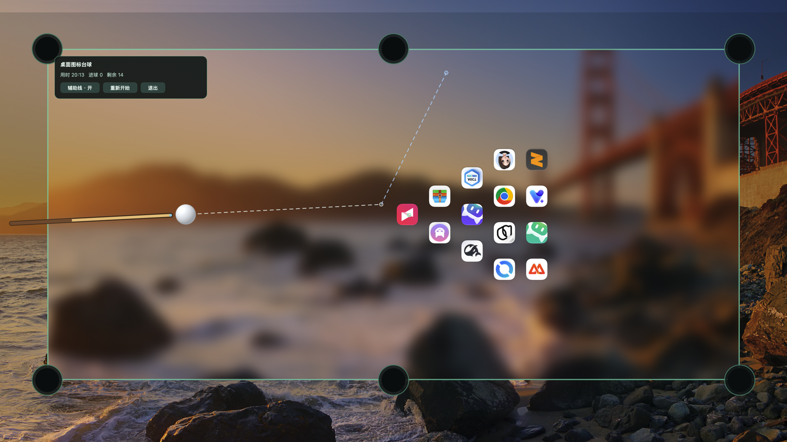

# 桌面图标台球 · macOS 版

把 macOS 桌面上的真实图标当作台球,在桌面上开一局台球。本项目是 Windows 开源项目
[desktop-icon-billiards](https://github.com/liuxiaogang-com/desktop-icon-billiards) 的 macOS 原生移植,
使用 Swift / AppKit 编写,**零第三方依赖**。



## 特点

- **桌面即球桌**:以当前壁纸为背景,模糊成绒面球桌,真实桌面图标摆成球堆。
- **不动你的图标**:游戏窗口悬浮在 Finder 图标层之上、普通窗口之下,只是"遮住"图标,
  从不移动、改名或删除任何桌面文件;退出后桌面立即恢复原样。
- **完整手感**:瞄准辅助线、蓄力条、球杆动画、入袋粒子、白球落袋后自由摆球、清台结算。
- **物理与 Windows 版一致**:碰撞、摩擦、库边反弹、入袋判定逐帧对齐原版 Python 实现。

## 玩法

| 操作 | 效果 |
| --- | --- |
| 移动鼠标 | 瞄准(显示辅助线) |
| 按住左键 | 蓄力(力度条) |
| 松开左键 | 击球 |
| 白球落袋后点击空处 | 放置白球 |
| `R` | 重新开始 |
| `G` | 开关辅助线 |
| `Esc` 或 `Ctrl+Option+X` | 退出并恢复桌面 |

左上角 HUD 显示用时 / 进球 / 剩余,并提供「辅助线」「重新开始」「退出」按钮。

## 运行

需要 macOS 13+ 与 Swift 5.9+(Xcode 或 Command Line Tools)。

```bash
# 直接运行(读取真实桌面图标)
swift run DesktopIconBilliards

# 体验模式:不读桌面,用 /Applications 里的示例图标,无需任何权限
swift run DesktopIconBilliards --demo
```

打包成 .app(含图标与 ad-hoc 签名):

```bash
./build-app.sh
open build/DesktopIconBilliards.app          # 真实桌面
open build/DesktopIconBilliards.app --args --demo
```

## 权限说明

- **体验模式 `--demo` 不需要任何权限**,推荐第一次先用它体验。
- 真实桌面模式需要读取 `~/Desktop`,首次启动时 macOS 会弹出
  「文件与文件夹 → 桌面」授权,允许即可;拒绝则只能使用 `--demo`。
- 不需要辅助功能 / 屏幕录制权限;全局退出热键 `Ctrl+Option+X` 通过 Carbon 热键实现,无需授权。

## 构建与测试

```bash
swift build                 # 调试构建
swift run PhysicsTests      # 物理引擎测试(含与 Python 原版的逐帧对照)
swift run AppTests          # 输入 / HUD / 生命周期测试
./build-app.sh              # 生成 build/DesktopIconBilliards.app
```

## 实现要点

- 窗口层级设为 `kCGDesktopIconWindowLevel + 1`,恰好盖住 Finder 图标、又低于所有普通窗口。
- 物理坐标与渲染统一为左上角原点(y 向下),与原版 Python 保持一致,便于逐帧对照。
- 静态背景(壁纸+绒面+库边+袋口)一次性烘焙,每帧只绘制图标/白球/粒子,保证 60fps。
- 单实例 flock 锁;显示器参数变化时自动退出,避免错位。

## 许可

MIT,见 [LICENSE](LICENSE)。原版 Windows 项目版权归 LXG 所有。